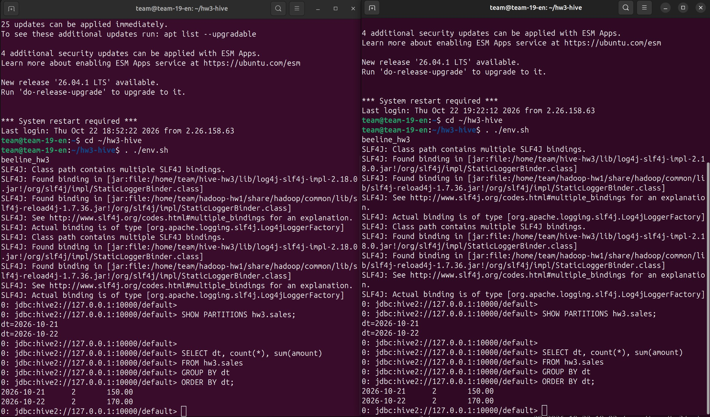
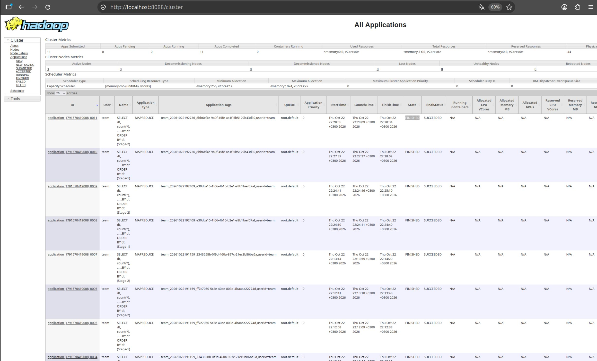

# Hive Cluster Deployment

Домашнее задание №3 по курсу **Data Platforms**.

Развёртывание Hive 4.0.0-alpha-2 на кластере из ДЗ-1 и ДЗ-2. HiveServer2 и отдельный Metastore работают на `team-19-en`. Метаданные таблиц хранятся в PostgreSQL, сами данные — в HDFS.

Для Hive используется Java 8, для Hadoop 3.4.2 — Java 11.

## Архитектура

| Компонент | Размещение / назначение |
|---|---|
| HiveServer2 | `team-19-en`, подключение клиентов Beeline |
| Hive Metastore | `team-19-en`, работа с метаданными таблиц |
| PostgreSQL | Хранение метаданных Hive |
| HDFS | Хранение данных таблиц |
| YARN | Выполнение запросов через MapReduce |

## Структура проекта

```text
hw3/
├── env.sh
├── deploy.sh
├── load.sh
├── check.sh
├── test_local.py
├── README.md
├── results/
└── images/
    ├── beeline-clients.png
    └── yarn-applications.png
```

### Скрипты

| Файл | Назначение |
|---|---|
| `env.sh` | Настройка окружения и подключение к Beeline |
| `deploy.sh` | Установка и запуск HiveServer2 и Metastore |
| `load.sh` | Загрузка CSV-данных в партиции |
| `check.sh` | Проверка работы двух клиентов и SQL-запросов |
| `test_local.py` | Локальная проверка синтаксиса и обработки CSV |
| `results/` | Результаты проверок и логи |
| `images/` | Скриншоты проверок для отчёта |

## Требования

- Ubuntu/Debian с `systemd`;
- пользователь `team` с доступом к `sudo`;
- работающие HDFS и YARN из предыдущих ДЗ;
- Hadoop в `/home/team/hadoop-hw1`;

## Развёртывание

### 1. Подключение к edge

```bash
ssh team@178.236.27.75
```

### 2. Получение проекта

```bash
git clone https://github.com/nikepf/data_platform_team_19.git
cd data_platform_team_19/hw3
```

### 3. Проверка кластера

```bash
~/hadoop-hw1/bin/hdfs dfsadmin -report
~/hadoop-hw1/bin/yarn node -list
```

Ожидается три работающие DataNode и три NodeManager

### 4. Проверка и запуск Hive

```bash
python3 test_local.py
bash deploy.sh
```

Скрипт `deploy.sh` устанавливает и запускает HiveServer2 и отдельный Metastore

## Загрузка данных

Загрузить данные из файла по умолчанию:

```bash
bash load.sh
```

Указать CSV и дату партиции вручную:

```bash
bash load.sh /tmp/sales.csv 2026-10-23
```

## Проверка

После загрузки данных выполнить:

```bash
bash check.sh
```

Скрипт проверяет работу двух клиентов Beeline и выполнение SQL-запросов через MapReduce на YARN. Код завершения `0` означает успешное прохождение проверок.

Посмотреть сохранённые результаты:

```bash
cat results/services.txt
cat results/partitions.txt
cat results/client-1.txt
cat results/client-2.txt
```

Пример вывода:

```text
2026-10-21    2    150.00
2026-10-22    2    170.00
```

## Проверка двух клиентов вручную

Открыть два SSH-терминала. В каждом перейти в каталог `hw3` и выполнить:

```bash
. ./env.sh
beeline_hw3
```

Затем в каждом клиенте выполнить:

```sql
SHOW PARTITIONS hw3.sales;

SELECT dt, count(*), sum(amount)
FROM hw3.sales
GROUP BY dt
ORDER BY dt;
```

Дождаться результата в обоих терминалах. Для выхода из Beeline использовать `!quit`.

## Проверка служб

Статус HiveServer2 и Metastore:

```bash
sudo systemctl status hive-hw3-metastore hive-hw3-hiveserver2 --no-pager
```

Последние сообщения журналов:

```bash
sudo journalctl -u hive-hw3-metastore -u hive-hw3-hiveserver2 -n 100 --no-pager
```

Остановка и повторный запуск:

```bash
sudo systemctl stop hive-hw3-hiveserver2 hive-hw3-metastore
sudo systemctl start hive-hw3-metastore hive-hw3-hiveserver2
```

## Результаты

В каталоге `results/` сохраняются:

- статусы служб и список партиций;
- результаты и логи двух клиентов Beeline;
- список файлов HDFS — `hdfs.txt`;
- список приложений YARN — `yarn.txt`.

### Два клиента Beeline

Оба клиента подключены к HiveServer2, видят партиции `hw3.sales` и возвращают одинаковый результат агрегирующего запроса.



### YARN

В YARN UI видны завершённые MapReduce со статусом `SUCCEEDED`, запущенные при выполнении запросов Hive



Скриншоты хранятся в каталоге `images/` рядом с `README.md` и включаются в репозиторий вместе с ним.

## Участники

| Участник | Telegram | GitHub |
|---|---|---|
| Николай Епифанов | `@lklklklklk26` | https://github.com/nikepf |
| Сергей Зайцев | `@cep3au` | https://github.com/serzai |
| Павел Ефимов | `@pafimov` | https://github.com/pafimov |
| Эмилия Шмыгина | `@Emi_shhh` | https://github.com/EmiliaShh |
