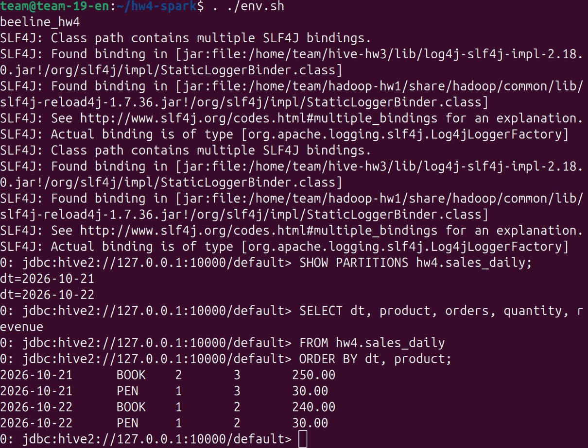
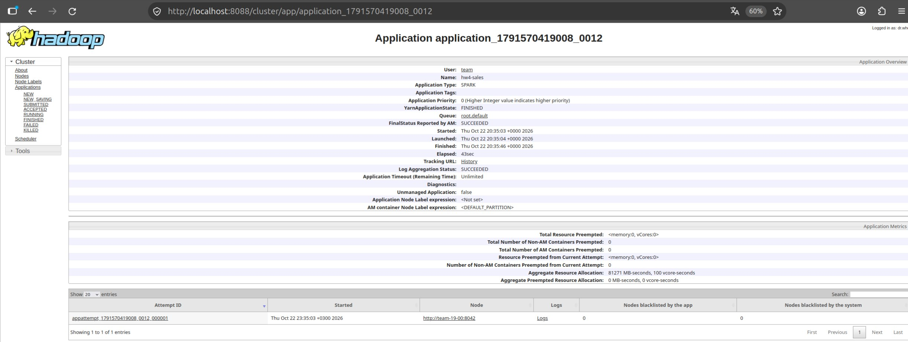

# Spark on YARN

Домашнее задание №4 по курсу **Data Platforms**.

Развёртывание Apache Spark на существующем кластере Hadoop с запуском задач через YARN. Spark читает CSV из HDFS, обрабатывает данные и сохраняет результат в Parquet с партиционированием по дате. Результат доступен через внешнюю таблицу Hive `hw4.sales_daily`.

## Структура проекта

```text
hw4/
├── README.md
├── env.sh
├── deploy.sh
├── data.csv
├── pipeline.py
├── run.sh
├── check.sh
├── test_local.py
├── results/
│   ├── spark.log
│   ├── table.log
│   ├── partitions.txt
│   ├── hive.txt
│   ├── hdfs.txt
│   └── yarn.txt
└── images/
    ├── hive-result.png
    └── yarn-application.png
```

### Скрипты

| Файл | Назначение |
|---|---|
| `env.sh` | Настройка окружения Spark и подключение Beeline |
| `deploy.sh` | Установка и настройка Spark |
| `data.csv` | Исходные данные |
| `pipeline.py` | Чтение, преобразование и запись данных |
| `run.sh` | Загрузка данных в HDFS, запуск Spark и создание таблицы Hive |
| `check.sh` | Проверка таблицы Hive и статуса приложения YARN |
| `test_local.py` | Локальная проверка преобразований и записи Parquet без YARN |

## Требования

- Ubuntu/Debian, пользователь `team`, доступ к `sudo` и интернету;
- работающие HDFS и YARN из ДЗ-1 и ДЗ-2;
- работающий Hive из ДЗ-3;
- Hadoop в `~/hadoop-hw1`;
- Hive в `~/hive-hw3`.


## Развёртывание

### 1. Подключение

```bash
ssh team@178.236.27.75
```

### 2. Получение проекта

После добавления папки `hw4` в репозиторий:

```bash
git clone https://github.com/nikepf/data_platform_team_19.git
cd data_platform_team_19/hw4
```

### 3. Проверка кластера

```bash
~/hadoop-hw1/bin/hdfs dfsadmin -report
~/hadoop-hw1/bin/yarn node -list
sudo systemctl is-active hive-hw3-metastore hive-hw3-hiveserver2
free -m
```

Ожидается три работающие DataNode, три NodeManager и две активные службы Hive.

### 4. Установка и запуск

```bash
bash deploy.sh
bash run.sh
```

Просмотр лога выполнения:

```bash
tail -f results/spark.log
```

## Обработка данных

В `pipeline.py` используется одна `SparkSession`. Конфигурацию HDFS и YARN Spark получает из `~/hadoop-hw1/etc/hadoop`.

Исходный CSV содержит 6 строк. В ходе обработки:

1. Удаляются лишние пробелы в названиях товаров, названия приводятся к верхнему регистру.
2. Количество и цена преобразуются в числовые типы, дата — в тип даты.
3. Исключается строка с нулевым количеством.
4. По дате и товару рассчитываются количество заказов, количество товаров и выручка.

После группировки остаются 4 строки. Результат записывается в Parquet с `partitionBy('dt')` в каталог `/user/team/hw4/sales_daily`.

Поверх файлов создаётся внешняя таблица Hive `hw4.sales_daily`. Партиции регистрируются командой `MSCK REPAIR TABLE ... SYNC PARTITIONS`.

## Проверка

```bash
bash check.sh
echo $?
```

Код `0` означает успешное выполнение проверок.

Посмотреть результаты:

```bash
cat results/partitions.txt
cat results/hive.txt
cat results/yarn.txt
```

Ожидаемые партиции:

```text
dt=2026-10-21
dt=2026-10-22
```

Результат запроса (`dt`, `product`, `orders`, `quantity`, `revenue`):

```text
2026-10-21    BOOK    2    3    250.00
2026-10-21    PEN     1    3     30.00
2026-10-22    BOOK    1    2    240.00
2026-10-22    PEN     1    2     30.00
```

На кластере приложение `application_1791570419008_0012` (`hw4-sales`) завершилось с типом `SPARK`, состоянием `FINISHED` и итоговым статусом `SUCCEEDED`. Обе партиции успешно прочитаны через Hive.

## Проверка через Beeline

Из папки `hw4`:

```bash
. ./env.sh
beeline_hw4
```

После подключения выполнить:

```sql
SHOW PARTITIONS hw4.sales_daily;

SELECT dt, product, orders, quantity, revenue
FROM hw4.sales_daily
ORDER BY dt, product;
```

Для выхода из Beeline: `!quit`.

## Результаты

| Файл | Содержимое |
|---|---|
| `results/spark.log` | Лог запуска Spark и ID приложения |
| `results/table.log` | Создание таблицы Hive и регистрация партиций |
| `results/partitions.txt` | Список партиций |
| `results/hive.txt` | Результат SQL-запроса к таблице |
| `results/hdfs.txt` | Каталоги партиций и файлы Parquet в HDFS |
| `results/yarn.txt` | Статус Spark-приложения в YARN |

### Результат запроса в Beeline



### Успешное Spark-приложение в YARN



## Участники

| Участник | Telegram | GitHub |
|---|---|---|
| Николай Епифанов | `@lklklklklk26` | https://github.com/nikepf |
| Сергей Зайцев | `@cep3au` | https://github.com/serzai |
| Павел Ефимов | `@pafimov` | https://github.com/pafimov |
| Эмилия Шмыгина | `@Emi_shhh` | https://github.com/EmiliaShh |
